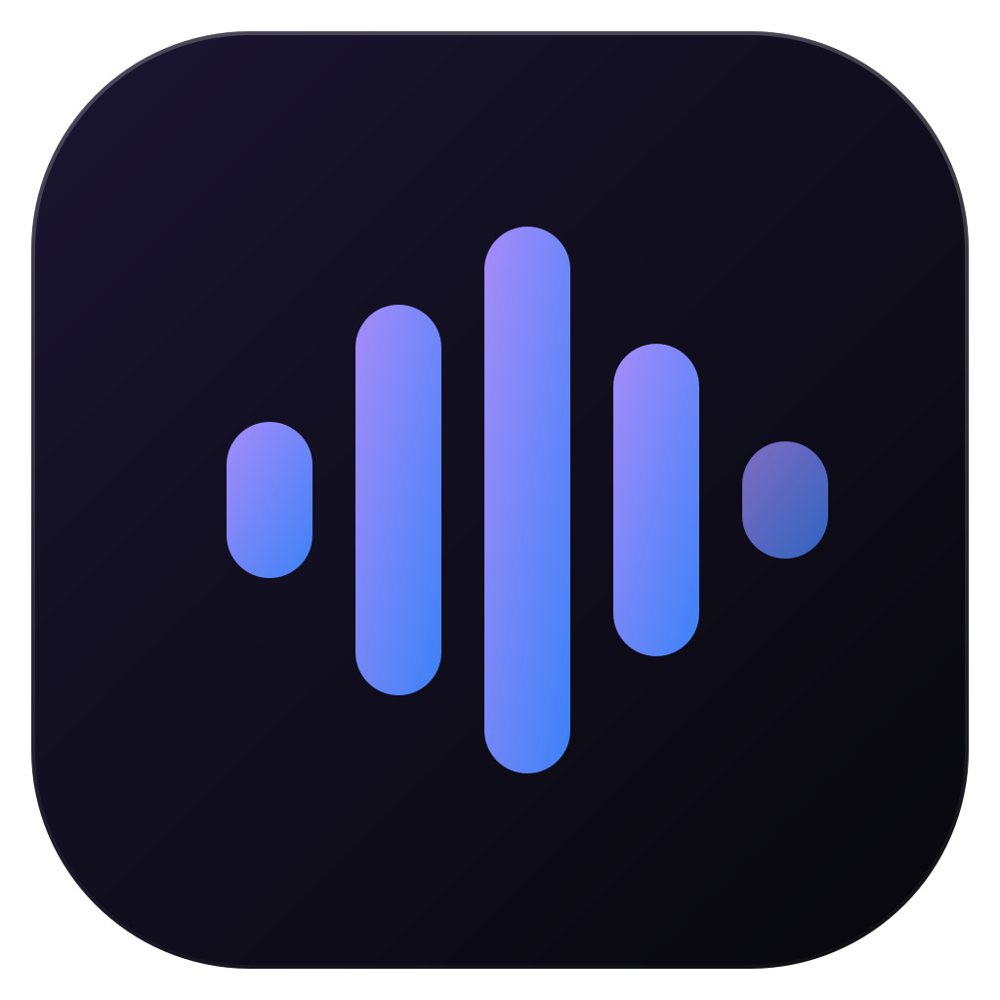
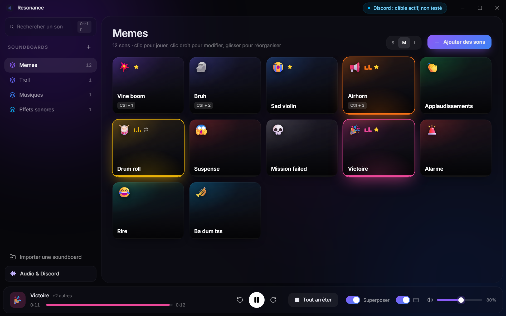
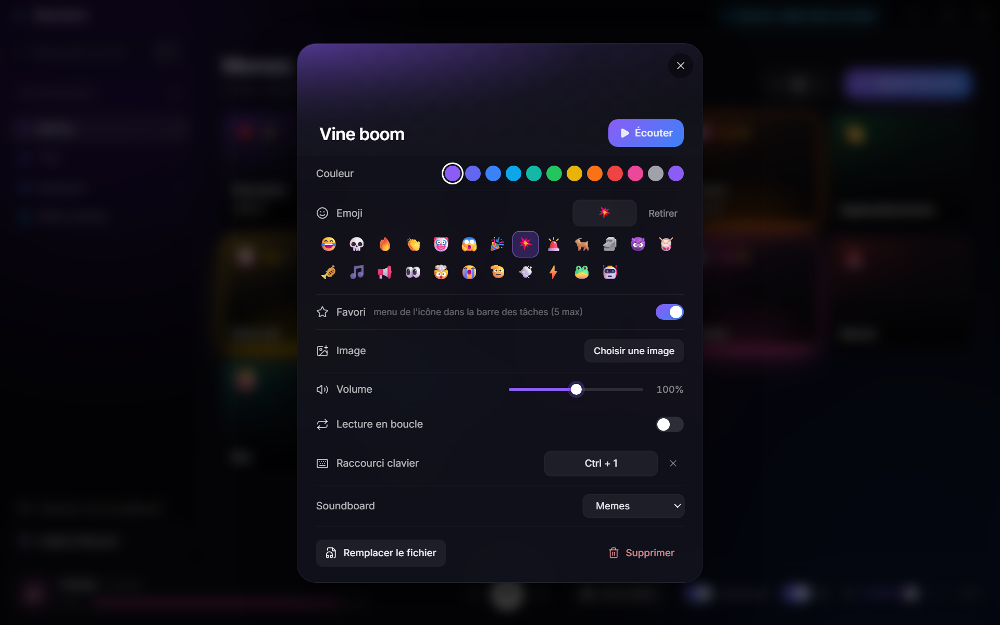
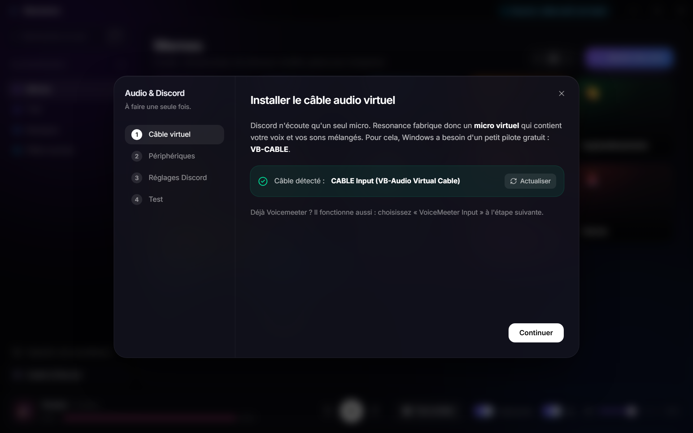

<p align="center"></p>

<h1 align="center">Resonance</h1>

<p align="center">Soundboard Windows pour Discord. Vous importez vos sons, vous cliquez, et vos amis les entendent dans le salon vocal, mélangés à votre voix.</p>

<p align="center"><a href="https://github.com/DanyalRez/Resonance/releases/latest"><b>⬇ Télécharger l'installateur Windows</b></a></p>



| Éditeur d'un son | Assistant Audio & Discord |
| --- | --- |
|  |  |

<sub>Captures faites avec des sons fictifs.</sub>

## Comment ça marche

Discord n'accepte qu'un seul micro. Resonance crée donc un « micro virtuel » qui mélange deux sources :

```
Vrai micro ──┐
             ├─► Resonance ─► CABLE Input ══ VB-CABLE ══► CABLE Output ─► Discord (micro)
Vos sons ────┘        │
                      └─► Vos écouteurs (pour vous entendre)
```

Le moteur audio est natif (Rust : `cpal` pour les périphériques, `symphonia` pour décoder). Il joue chaque son sur deux sorties à la fois : vos écouteurs, et le câble virtuel avec votre micro mixé dedans. Le bouton **Tester** envoie un bip dans le câble et écoute l'autre bout. Le statut « transmission vérifiée » ne s'affiche que si le bip a vraiment été reçu.

## Configuration (une seule fois)

1. **Installer VB-CABLE** (gratuit) : https://vb-audio.com/Cable/
   Extraire le zip → clic droit sur `VBCABLE_Setup_x64.exe` → *Exécuter en tant qu'administrateur* → *Install Driver* → redémarrer.
2. **Ouvrir Resonance** : l'assistant « Audio & Discord » s'ouvre au premier lancement. Il détecte le câble tout seul. Choisissez votre micro et vos écouteurs.
3. **Dans Discord** → Paramètres → Voix et vidéo :
   - Périphérique d'entrée : **CABLE Output (VB-Audio Virtual Cable)**
   - Périphérique de sortie : vos écouteurs (jamais « CABLE Input »)
   - Mode de saisie : **Détection de la voix**
   - Suppression du bruit : **Aucune** (Krisp coupe la musique et les effets)
   - Annulation de l'écho : désactivée si vous portez un casque
4. **Tester** depuis la dernière étape de l'assistant.

> Après l'installation de VB-CABLE, Windows en fait parfois la sortie par défaut. Si vous n'entendez plus rien sur le PC, remettez vos écouteurs comme sortie par défaut, ou choisissez-les dans l'assistant.

## Fonctions

- Soundboards illimitées : création, renommage (double-clic), suppression, export/import en fichier `.resonance` (sons et images inclus).
- Sons : import multiple ou glisser-déposer de fichiers (MP3, WAV, OGG, FLAC, M4A/AAC), nom et emoji personnalisés (gardés seulement dans l'app, le fichier n'est jamais renommé), couleur, image, volume par son (0 à 200 %), boucle, raccourci clavier global, remplacement du fichier, suppression.
- Lecteur : pause / reprise, reculer et avancer de 5 secondes.
- 5 favoris dans l'icône de la barre des tâches (icônes cachées) : un clic sur l'icône ouvre le menu, un clic sur un favori le joue. La croix de la fenêtre range Resonance dans cette icône. « Quitter » se trouve dans son menu.
- Grille : réorganisation par glisser-déposer. Pour déplacer un son vers une autre soundboard, glissez-le sur son nom dans la barre latérale, ou passez par l'éditeur (clic droit). Taille des boutons S/M/L.
- Lecture : animation et barre de progression sur chaque bouton, « Tout arrêter », volume général, superposition des sons ou coupure du précédent, recliquer sur un son l'arrête.
- Recherche instantanée dans toutes les soundboards (Ctrl+F).
- Raccourcis globaux (marchent même app en arrière-plan) avec interrupteur pour tous les couper. Un raccourci déjà pris par une autre app est signalé.
- Sauvegarde automatique dans `%APPDATA%\com.danyalrez.resonance` (`library.json` + dossiers `sounds/` et `images/`). Écriture atomique. Un fichier corrompu est mis de côté, jamais écrasé.
- Fichiers manquants signalés sur le bouton, avec remplacement en un clic.

## Compiler

Prérequis : Node 20+, Rust (toolchain `stable-x86_64-pc-windows-gnu` ou msvc), WebView2 (déjà présent sous Windows 10/11).

```bash
npm install
```

```bash
npm run app:dev
```

```bash
npm run app
```

`npm run app` produit l'exécutable `resonance.exe` dans `src-tauri/target/release/` et l'installateur `Resonance_<version>_x64-setup.exe` dans `src-tauri/target/release/bundle/nsis/`.

> Toolchain GNU et chemin avec des espaces : `windres` ne les supporte pas. Placez alors le dossier de build ailleurs avec un `src-tauri/.cargo/config.toml` local contenant `[build] target-dir = "C:/chemin/sans/espaces"`.

Tests du moteur audio et de la validation des chemins :

```bash
cd src-tauri && cargo test
```

## Limites connues

- Il faut un pilote de câble virtuel (VB-CABLE ou Voicemeeter). Aucune application ne peut créer un micro Windows sans pilote.
- Le test vérifie que le son arrive dans le câble. Il ne peut pas lire les réglages de Discord : choisissez bien « CABLE Output » comme entrée dans Discord.
- Pas de reconnexion automatique si un périphérique est débranché : rouvrez « Audio & Discord » ou changez de périphérique pour relancer.
- Opus et WMA ne sont pas pris en charge (limite du décodeur).
